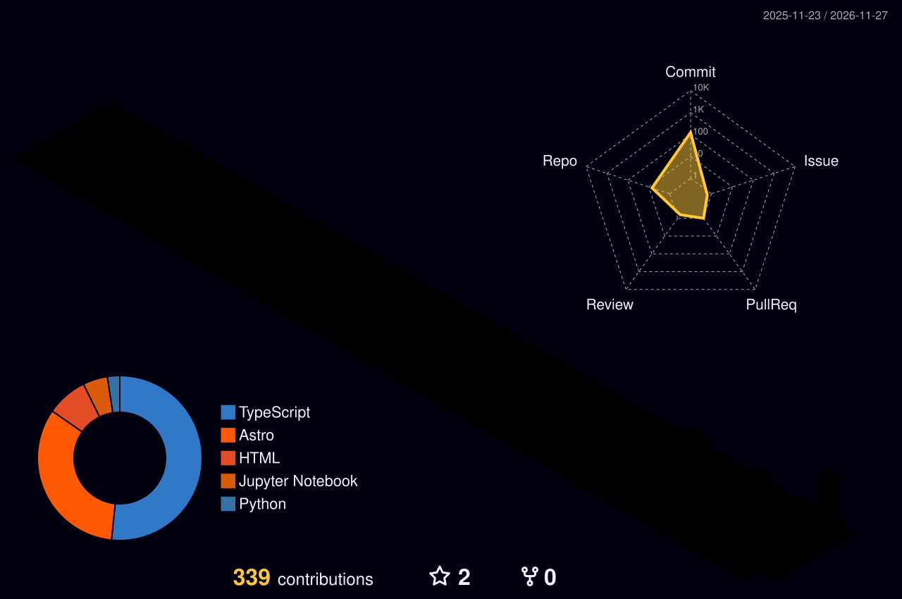

<div align="center">

<a href="https://mubashir1255.github.io/mubashir1255/"></a>

<a href="https://mubashir1255.github.io/mubashir1255/"></a>

<a href="https://git.io/typing-svg"></a>

<a href="https://github.com/mubashir1255"></a>
<a href="https://mubashir-fayyaz.vercel.app"></a>
<a href="mailto:1255mubashir@gmail.com"></a>
<a href="https://github.com/mubashir1255?tab=followers"></a>

</div>

<br />



<div align="center">
  
</div>

```text
> PLAYER.LOG
  ▸ Information Technology student at the University of Lahore (graduating Sep 2027)
  ▸ Building AgroBid Pakistan: an online mandi with live auctions for farmers
  ▸ Full-stack developer and Cyber & DevOps Engineer
  ▸ Secures and ships apps: CI/CD pipelines, containers, cloud and hardened Linux
  ▸ Working with AWS, Docker, Kubernetes and GitHub Actions; also into AI
  ▸ Open to internships, junior roles and project collaborations
  ▸ Learns best by turning ideas into working projects
```



<div align="center">

**⚔️ LANGUAGES**<br />


**🛡️ FRONTEND & MOBILE**<br />


**🧪 BACKEND, DATA & AI**<br />


**🔐 CYBER, CLOUD & DEVOPS**<br />


</div>



<p align="center"><sub>My four most-played repositories, ranked by commits.</sub></p>

<table>
  <tr>
    <td width="50%" valign="top">
      <h3>🌾 AgroBid Pakistan</h3>
      <p><code>MAIN QUEST</code> <code>LIVE</code> <code>120+ COMMITS</code></p>
      <p>An online mandi for Pakistani farmers: sell crops and livestock at a fixed price or by live auction. Full Urdu (right-to-left) and English, built phone-first. Final-year project.</p>
      <p><b>Loot:</b> live bidding with server-checked rules · phone push alerts · verified sellers with AI ID-card checks · wallet with security deposit · AI listing screening · installable app</p>
      <p><b>Gear:</b> Next.js · React · TypeScript · Supabase (Postgres, Realtime) · Tailwind · Gemini · Vercel</p>
      <p><a href="https://agrobid-pk.vercel.app"><b>▶ PLAY</b></a> &nbsp;·&nbsp; <a href="https://github.com/mubashir1255/agrobid">SOURCE</a></p>
    </td>
    <td width="50%" valign="top">
      <h3>🧰 DevEverTools</h3>
      <p><code>SIDE QUEST</code> <code>LIVE</code> <code>45 COMMITS</code></p>
      <p>A free, privacy-first toolbox of 35+ developer utilities that run entirely in the browser: no signup, no tracking, works offline.</p>
      <p><b>Loot:</b> JSON formatter and JSON → TypeScript · cURL converter · Zod schema generator · hash generator · SQL formatter · hex inspector</p>
      <p><b>Gear:</b> Next.js · React · TypeScript · Tailwind</p>
      <p><a href="https://dev-ever-tools.vercel.app"><b>▶ PLAY</b></a> &nbsp;·&nbsp; <a href="https://github.com/mubashir1255/DevEverTools">SOURCE</a></p>
    </td>
  </tr>
  <tr>
    <td width="50%" valign="top">
      <h3>💥 Portfolio</h3>
      <p><code>SIDE QUEST</code> <code>LIVE</code> <code>41 COMMITS</code></p>
      <p>My personal site in a comic-panel style: ink panels, halftone dots and numbered chapters, with a "Play mode" that adds anime-style effects to buttons and tabs.</p>
      <p><b>Loot:</b> fully static, works without JavaScript · effects respect reduced motion · content in typed data files</p>
      <p><b>Gear:</b> Astro · Tailwind CSS · TypeScript</p>
      <p><a href="https://mubashir-fayyaz.vercel.app"><b>▶ PLAY</b></a> &nbsp;·&nbsp; <a href="https://github.com/mubashir1255/Portfolio">SOURCE</a></p>
    </td>
    <td width="50%" valign="top">
      <h3>🐾 Animal Classifier AI</h3>
      <p><code>BONUS LEVEL</code> <code>AI</code> <code>6 COMMITS</code></p>
      <p>A deep-learning model that tells apart five animals (cat, dog, cow, lion, deer) using transfer learning on MobileNetV2.</p>
      <p><b>Loot:</b> 98.8% validation accuracy · data augmentation against overfitting · upload your own photo in Colab</p>
      <p><b>Gear:</b> Python · TensorFlow · Keras · Jupyter</p>
      <p><a href="https://github.com/mubashir1255/Animal-Classifier-AI"><b>▶ PLAY</b></a></p>
    </td>
  </tr>
</table>



<div align="center">


</div>



<div align="center">



<picture>
  <source media="(prefers-color-scheme: dark)" srcset="https://raw.githubusercontent.com/mubashir1255/mubashir1255/output/snake-dark.svg" />
  <source media="(prefers-color-scheme: light)" srcset="https://raw.githubusercontent.com/mubashir1255/mubashir1255/output/snake-light.svg" />
  
</picture>


</div>



<div align="center">

**Looking for a teammate?** I'm happy to talk tech, build something useful together, or join your team as an intern.

[](https://github.com/mubashir1255)
[](https://mubashir-fayyaz.vercel.app)
[](mailto:1255mubashir@gmail.com)

<a href="https://mubashir1255.github.io/mubashir1255/"></a>

</div>
